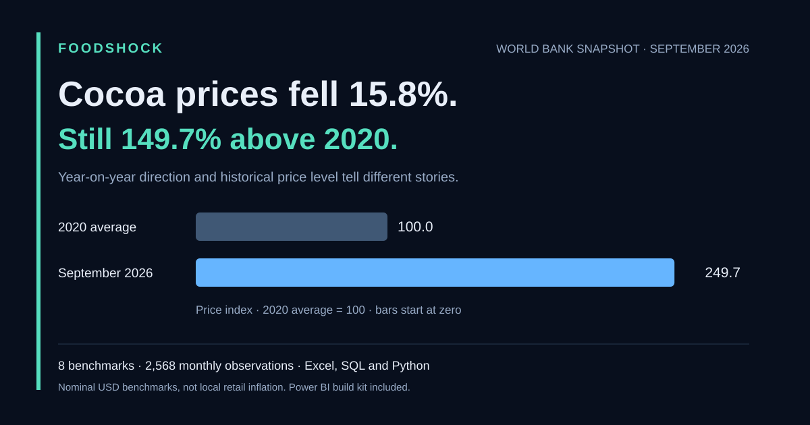
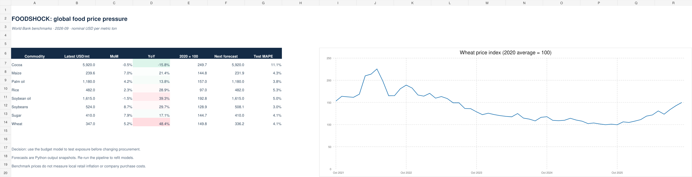

# FOODSHOCK
## Global Food Price Risk and Procurement Intelligence

**Cocoa fell 15.8% year on year, yet remained 149.7% above its 2020 average.** Explore the price direction, historical level and procurement implications behind that contrast.



**Problem:** international food benchmark shocks can make procurement budgets unstable. Buyers need to distinguish sustained price pressure, sudden changes and uncertainty before reviewing sourcing commitments.

**Solution:** an auditable analytics workflow that monitors eight food benchmarks, flags unusual monthly changes, evaluates next-month forecasting models, and tests hypothetical commodity and currency shocks against a procurement budget.

This is an independent portfolio project. It does not establish local food inflation, predict hunger, identify the cause of a price shock or demonstrate realized savings.

**Audit and sharing:** [Issues and fixes](docs/AUDIT_AND_FIXES.md) · [LinkedIn post and carousel script](docs/LAUNCH_CONTENT.md) · [Source metadata](data/raw/source_metadata.json)

**Explore:** [Findings and proposed actions](docs/PROJECT_REPORT.md) · [Excel workbook](FOODSHOCK_Analysis.xlsx) · [Dashboard file](FOODSHOCK_Dashboard.html) · [Power BI build guide](powerbi/BUILD_GUIDE.md) · [Validation evidence](docs/VALIDATION.md)



### Selected findings

- Seven of eight benchmarks increased year on year in September 2026. Wheat increased 48.4%.
- Cocoa fell 15.8% year on year, yet remained about 149.7% above its 2020 average.
- Last-price forecasts won validation for five commodities. Ridge regression underperformed that baseline in two of its three selected test series.

The project contains 2,568 commodity-month observations from January 2000 through September 2026. All numerical findings refer to the included source snapshot.

## Start here — no installation needed

1. Open **FOODSHOCK_Dashboard.html** in Edge, Chrome or Firefox. It is self-contained and works offline. Select a commodity, change the history window, explore all four pages, adjust budget assumptions and export selected history to CSV.
2. Open **FOODSHOCK_Analysis.xlsx** in Excel. Overview contains formula-linked benchmark comparisons and editable native charts. Scenario contains a basket model with yellow editable inputs. History preserves all 321 months × eight commodities in wide form. Forecasts contains Python model output snapshots.
3. Read **docs/PROJECT_REPORT.md** for the findings, proposed actions, methodology and interview explanation.
4. Open **foodshock.sqlite** in a SQLite browser, or use Python's built-in sqlite3. Inspect the SQL views and queries in sql/analysis.sql.
5. Follow **powerbi/BUILD_GUIDE.md** to assemble the Power BI version using the supplied Power Query, DAX, theme and report-page specification.

**Validation:** the Python rebuild and 10 regression tests pass on Windows and Linux. Chromium desktop/mobile smoke checks cover navigation, scenario validation, a real CSV download, page errors and mobile overflow. See the [verified workflow run](https://github.com/purushotmanmooper96-bit/foodshock-global-food-price-intelligence/actions/runs/39495977933) and [validation evidence](docs/VALIDATION.md).

**Delivery boundary:** Power BI assets are a build kit, not a completed .pbix. The Excel file is a snapshot with documented manual refresh steps. Browser smoke checks do not establish pixel-perfect appearance or every-browser compatibility.

## Tool responsibilities

| Tool | Work performed |
|---|---|
| Excel | Native charts, formula-based MoM/YoY/index comparisons, editable quantity/price/FX budget model and validation rules |
| SQL | SQLite database, monthly lag calculations, latest-month view, annual summary with month counts, model comparison view |
| Python | Source parsing, unit normalization, calendar validation, features, temporal model selection/backtesting, empirical uncertainty bands, HTML/data generation |
| Power BI | Supplied Power Query transformations, dimension/fact relationships, context-aware DAX, scenario parameters, theme and page build instructions; Desktop assembly remains |
| HTML/JavaScript | Offline dashboard, SVG charts, commodity/history filters, forecast evaluation, budget sliders, evidence page, CSV export |

## Data and provenance

- Provider: World Bank Commodity Price Data, Pink Sheet.
- Source page: https://www.worldbank.org/en/research/commodity-markets
- Source snapshot: data/raw/worldbank_monthly.xlsx, explicitly using **Monthly Prices**.
- Retrieved: 21 October 2026. Workbook update label: 2 October 2026.
- Analysis: January 2000–September 2026, eight commodities, **2,568 commodity-month rows**.
- Benchmarks: Wheat (US HRW), Maize, Rice (Thai 5%), Soybeans, Palm oil, Soybean oil, Sugar (world), Cocoa.
- USD/kg sugar and cocoa are multiplied by 1,000 to obtain USD per metric ton. Other selected series already use USD/metric ton.
- Exact source SHA-256, row counts, provenance and source caveat: data/processed/manifest.json.
- Original workbook includes an ancillary **Mismatch Details** sheet. The pipeline never treats its first sheet as price data. No independent benchmark verification or reconciliation of that ancillary comparison was performed.
- Preserve World Bank attribution and review its dataset terms before republishing original source files: https://www.worldbank.org/en/about/legal/terms-of-use-for-datasets . The project does not relicense source data.

## Rebuild Python, SQL and dashboard

Use a Python environment compatible with the packages in requirements.txt. Python 3.11–3.13 is a practical choice; this build was tested with the supplied runtime, as recorded in docs/VALIDATION.md.

Windows PowerShell, from the project folder (Code > Download ZIP and extract it, or clone this repository):

```powershell
py -0p
py -3.13 -m venv .venv
.\.venv\Scripts\python.exe -m pip install -r requirements.txt
.\.venv\Scripts\python.exe python\pipeline.py
.\.venv\Scripts\python.exe -m unittest discover -s tests -v
Start-Process .\FOODSHOCK_Dashboard.html
```

Use an installed compatible Python version in place of `-3.13` if needed. No paid API, API key, GPU or AI service is used. Dependencies require a one-time download. Running the dashboard needs only a browser.

Optional JavaScript checks if Node.js is installed:

```powershell
node tests\test_dashboard.cjs
```

The pipeline operates on the included snapshot and does not download data automatically. To update, download the current monthly workbook from the source page, archive your old snapshot, replace data/raw/worldbank_monthly.xlsx and inspect series/units/update date. Update data/raw/source_metadata.json with the verified source URL, source update/retrieval dates and the new workbook SHA-256, then run the pipeline and tests and refresh Power BI. The pipeline rejects a changed file whose hash or update label disagrees with the metadata. Record revisions in your project changelog. Revisions to historical values can change backtest results.

**Excel refresh:** this delivered workbook is a snapshot. Editing existing History values updates its formula-linked summaries and charts. Forecasts are imported model results, not Excel retraining. To refresh them, copy the rebuilt model_metrics results into Forecasts with the same row layout and the matching next-month forecasts into column H. Adding months also requires extending the History table and updating the Overview last-month, prior-month/prior-year and chart references. Do not present it as an automatic Excel refresh.

## Models

1. **Shock detection:** current log return versus preceding 36 months; z ≥ 2 upward, z ≤ −2 downward. Exploratory threshold; no crisis probability or validated early-warning claim.
2. **Forecast competition:** last-price, seasonal-naive and ridge on lagged log prices/trailing averages. Select using the preceding 24 validation months; report separate final-24-month test errors. Ridge is training-scaled with fixed regularization. Each prediction uses strictly earlier prices.
3. **Uncertainty:** selected model's absolute validation log residuals calibrate an empirical 80% band. Report actual test coverage instead of promising 80% accuracy.
4. **Budget exposure:** baseline × (1 + commodity shock × pass-through) × (1 + currency depreciation). Excel adds an eight-commodity basket with editable quantities. Sliders and quantities are illustrative assumptions.

## Repository guide

```text
FOODSHOCK_Dashboard.html     Self-contained interactive dashboard
FOODSHOCK_Analysis.xlsx      Excel analysis and basket scenario
foodshock.sqlite            Queryable database with analytical views
python/pipeline.py          Reproducible ETL and forecasting
python/dashboard_template.html
sql/analysis.sql            Views and investigation queries
powerbi/                    Import queries, DAX, theme, Desktop guide
data/raw/                   Preserved source workbook
data/processed/             Facts, dimensions, forecasts, metrics, provenance
tests/                      Python and JavaScript logic checks
docs/                       Findings, data dictionary and validation evidence
```

## Present it honestly

“I built an independent global food-price analytics project using Excel, SQL and Python, with Power BI import and report assets. It normalizes 2,568 observations, compares forecasting methods on separate time periods, monitors unusual price changes and tests procurement-budget scenarios. The analysis exposed cases where simpler forecasts outperform regression.”

Once the Desktop report is assembled and validated, change the Power BI wording to describe the actual completed report. Keep this project separate from employment responsibilities on your resume. Do not claim measured cost savings, production deployment, real-time feeds or country-level coverage.

## Audit validation

The October 2026 review independently reconciled all 2,568 observations and executed expanded JavaScript logic checks, the Windows/Linux Python test matrix and Chromium desktop/mobile smoke checks. [Inspect the verified run](https://github.com/purushotmanmooper96-bit/foodshock-global-food-price-intelligence/actions/runs/39495977933); its tested code is commit 0beebc0056f81050d975ec219f40f49b502d937c. See [audit findings](docs/AUDIT_AND_FIXES.md) for remaining boundaries.
